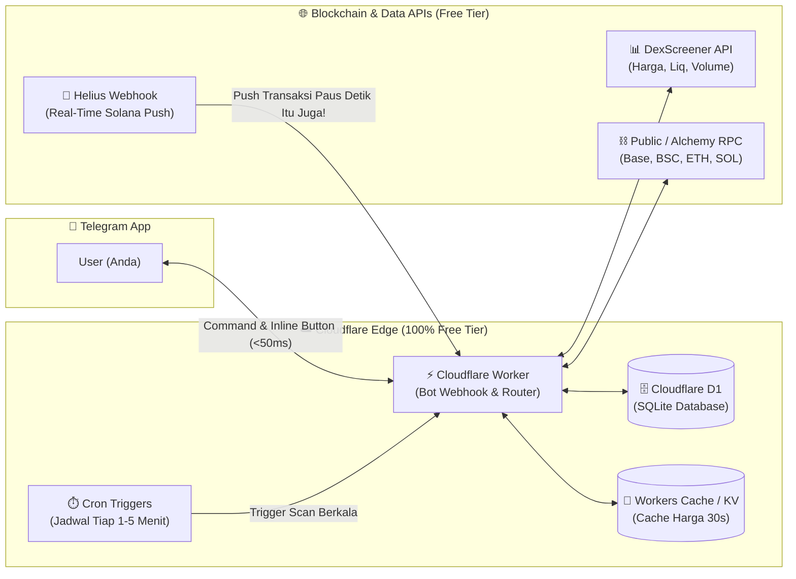

# 🤖 Analisis Mendalam, Audit Kode, & Master Plan Transformasi Crypto Tracker Bot

Dokumen ini berisi hasil audit menyeluruh terhadap kode sumber `crypto-tracker` saat ini, evaluasi kelayakan fungsi, daftar bug tersembunyi yang ditemukan, rekomendasi upgrade teknologi (**Vercel + Next.js $\rightarrow$ Cloudflare Workers + D1 + Helius Webhook**), serta rencana implementasi bertahap.

---

## 1. 🔍 Evaluasi Kondisi Bot Saat Ini: Apakah Sudah Oke?

Secara konsep dasar, bot yang ada di `frontend/app/api/tele-bot/route.ts` sudah memiliki fondasi yang baik (format pesan HTML rapi, auto-detect alamat kontrak, dan integrasi DexScreener). **Namun, setelah dibedah baris demi baris, ditemukan 6 masalah kritis (bug logika & celah keamanan)** yang membuat bot saat ini **belum siap pakai secara optimal**:

### 🚨 Daftar Bug & Kelemahan Kode Saat Ini

| No | Lokasi File | Temuan Masalah (Bug / Kelemahan) | Dampak Nyata |
| :-: | :--- | :--- | :--- |
| **1** | `tele-bot/route.ts` (Baris 641–678) | **Coin Scanner 100% Mati (Dead Logic):** Fungsi `executeRadarScan` mengecek `coin.rsi` dan `coin.volume_h24` dari tabel Supabase `tracked_coins`. Padahal tabel `tracked_coins` hanya menyimpan `contract_address`, `chain_network`, dan `label` (tidak pernah menyimpan kolom `rsi` atau `volume_h24`). | Fitur alert RSI Oversold/Overbought dan Volume Surge **tidak akan pernah menyala** sampai kapanpun. |
| **2** | `tele-bot/route.ts` (Baris 517–609) | **Whale Scanner Hanya Mengecek Koin Umur $\le$ 60 Menit & Hanya Solana:** Scanner mengabaikan dompet EVM (Base/BSC/ETH) dan mengabaikan pembelian paus jika token berumur $> 1$ jam, serta **tidak memberi notifikasi saat paus menjual (dump)** token. | Jika paus membeli \$100.000 token yang berumur 2 jam atau melakukan *dump*, Anda tidak mendapat alert sama sekali. |
| **3** | `tele-bot/route.ts` (Baris 431–433) | **Bug Double Dollar (`$$`) pada `/search`:** Fungsi `formatCompact()` sudah menambahkan simbol `$`, tetapi template pesan menambahkan `$` lagi (`$${mcap}`), menghasilkan tampilan `$$1.2M`. | Tampilan angka Market Cap, Liquidity, dan Volume di Telegram menjadi cacat (`$$`). |
| **4** | `tele-bot/route.ts` (Baris 520–545) | **N+1 Query Waterfall di Scanner:** Di dalam loop dompet $\rightarrow$ loop 10 transaksi $\rightarrow$ loop token transfer, bot memanggil Supabase `alert_logs` dan DexScreener satu per satu secara sekuensial. | Jika memantau $>5$ dompet, waktu eksekusi tembus $>10$ detik dan langsung terkena **Timeout Error** di Vercel. |
| **5** | `tele-bot/route.ts` (Baris 246–253) | **Tanpa Otorisasi Pengguna (Open Bot):** Bot membalas perintah dari `fromChatId` mana saja tanpa memfilter ID Telegram pemilik. | Orang asing yang tahu username bot Anda bisa melihat daftar dompet Anda dan menghabiskan kuota API Anda. |
| **6** | `history/route.ts` (Baris 143) | **Hardcoded Alchemy API Key:** Terdapat fallback key `'alch_N9FL-z41qp-r45WkzqTfZ'` di kode sumber publik. | Kunci API terekspos di GitHub publik dan rawan disalahgunakan pihak luar. |

---

## 2. ⚡ Evaluasi & Rekomendasi Upgrade Teknologi (Vercel vs Cloudflare)

Menggunakan **Vercel + Next.js** untuk menjalankan Bot Telegram dan Background Scanner memiliki keterbatasan fatal:
- **Vercel Hobby Cron hanya bisa berjalan 1x sehari** (tidak bisa scan tiap menit).
- **Batas Timeout 10 detik** pada Vercel Serverless Function sering memutus proses scan dompet.
- **Beban Framework Berat:** Memuat seluruh runtime Next.js 16 & React 19 hanya untuk membalas chat teks Telegram.

### 🏆 Rekomendasi Upgrade Arsitektur: **Cloudflare Stack + Helius Webhook**



### Perbandingan Teknologi Lama vs Rekomendasi Baru

| Komponen | Stack Saat Ini | Upgrade yang Direkomendasikan | Keuntungan Utama Upgrade |
| :--- | :--- | :--- | :--- |
| **Hosting & Runtime** | **Vercel (Next.js 16)** | **Cloudflare Workers** (TypeScript murni / Hono) | • **0ms Cold Start** (respon tombol chat instan)<br>• **100.000 request/hari gratis**<br>• Mendukung `ctx.waitUntil()` (proses scan jalan di background tanpa membuat chat Telegram menunggu) |
| **Penjadwalan (Scheduler)** | Vercel Cron (Limit 1x sehari di paket gratis) | **Cloudflare Cron Triggers** | • Bisa jalan **setiap menit (`* * * * *`) secara GRATIS** tanpa perlu menyewa VPS. |
| **Database** | **Supabase Free Tier** | **Cloudflare D1 (SQLite)** *(atau tetap Supabase)* | • Supabase gratis akan **otomatis mati (pause)** jika 7 hari tidak disentuh.<br>• **Cloudflare D1 tidak pernah pause**, terhubung lokal di edge (latensi $<2$ms), gratis 5 juta read/hari. |
| **Deteksi Transaksi Solana** | Polling `GET /transactions` tiap scan | **Helius Webhooks (Push Event)** | • **Real-time (1–2 detik)** begitu transaksi paus terjadi.<br>• **Hemat 99% kuota kredit Helius** karena tidak perlu polling berulang saat paus sedang diam. |
| **EVM Balance Fetcher** | Moralis API (Butuh API Key & Kuota) | **Native JSON-RPC Batch (`eth_getBalance`)** | • Gratis tanpa batas ke public RPC (`mainnet.base.org`, `bsc-dataseed`, dll.) dan bisa di-batch sekaligus. |

---

## 3. ✂️ Fungsi yang Tidak Efektif & Wajib Dihapus (Bloatware)

Untuk menjadikan bot sangat cepat, ringan, dan bebas perawatan rumit, fungsi/file berikut **sebaiknya dihapus**:

1. **Seluruh Antarmuka Web UI Next.js (`app/page.tsx`, `app/layout.tsx`, `app/components/TradeHistoryModal.tsx`, `app/globals.css`)**:
   - *Alasan:* Semua pemantauan dan manajemen sudah pindah ke Telegram. Menghapus UI memangkas $>350$ paket `node_modules` (React, Tailwind, PostCSS, Lucide Icons).
2. **Endpoint `app/api/whitelist/route.ts`**:
   - *Alasan:* **Orphaned / Dead Code.** Endpoint ini mengelola tabel `whitelist_tokens`, sedangkan scanner utama menggunakan `tracked_coins` sebagai whitelist. Keberadaannya membingungkan dan tidak terpakai.
3. **Dekoder Biner Metaplex Manual di `app/api/solana/route.ts`**:
   - *Alasan:* Membaca byte buffer PDA Metaplex satu per satu sangat lambat. DexScreener API dan Helius DAS API sudah menyediakan nama & simbol token secara instan.
4. **Ketergantungan Moralis & Axios (`package.json`)**:
   - *Alasan:* `axios` hanya dipakai di 1 file padahal Node.js dan Cloudflare Workers sudah memiliki native `fetch` berkecepatan tinggi. Moralis juga tidak diperlukan untuk sekadar cek saldo native.
5. **Skrip Statis `backend/index.js`**:
   - *Alasan:* Hanya mengecek dompet Vitalik (`0xd8dA...`) secara hardcode. Fungsinya sudah digantikan oleh watchlist dinamis di dalam bot.

---

## 4. ➕ Fungsi Baru yang Perlu Ditambahkan ke Bot

Agar bot menjadi asisten kripto pribadi yang lengkap di Telegram, berikut fitur yang perlu ditambahkan:

### A. Manajemen Penuh via Chat & Tombol Interaktif (Inline Keyboard)
Mengganti keharusan membuka web dengan tombol interaktif di setiap balasan bot:
- **Menu Utama (`/start` / `/menu`)**:
  ```text
  [ 📊 Portfolio Summary ]  [ 🎯 Watchlist Dompet ]
  [ 🪙 Koin Pantauan     ]  [ 🔥 Trending / Radar ]
  [ 🚫 Blacklist Token   ]  [ ⚙️ Pengaturan Bot   ]
  ```
- **Manajemen Dompet Langsung di Chat**:
  - `/addwallet <alamat> <chain> <nama>` — Menambah target paus baru dari HP.
  - Tombol `[ ⭐ Pin ]` dan `[ 🗑️ Hapus ]` langsung di bawah daftar dompet pada `/watchlist`.
- **Manajemen Koin Cepat (One-Tap Action)**:
  - Saat Anda paste alamat smart contract koin ke chat, bot membalas info harga + tombol:
    `[ ➕ Masukkan ke Pantauan ]` `[ 👥 Cek Top Holders ]` `[ 🛡️ Cek Keamanan RugCheck ]`

### B. Upgrade Logika Whale Alert (Beli & Jual + Semua Umur Token)
- **Whale Buy & Sell Alert**: Memberikan notifikasi baik saat paus **MEMBELI (🟢 BUY)** maupun saat paus **MENJUAL / DUMP (🔴 SELL)** token, lengkap dengan nilai USD dan persentase token yang dijual.
- **Filter Nilai Minimum (`MIN_WHALE_USD`)**: Hanya kirim notifikasi jika nilai transaksi paus di atas ambang batas (misal $\ge \$100$) agar Anda tidak terganggu oleh transaksi debu (*dust transactions*).
- **Dukungan EVM Whale Tracking (Base & BSC)**: Memantau transaksi token ERC-20 dompet paus di jaringan Base dan BSC, bukan hanya Solana.

### C. Quick Security & RugCheck Scanner
- Saat mengecek token atau menerima alert snipe baru, sertakan indikator keamanan singkat otomatis (dari RugCheck API gratis untuk Solana / GoPlus API gratis untuk EVM):
  - *Mint Authority* (Apakah dev masih bisa cetak token?)
  - *Freeze Authority / Honeypot* (Apakah token bisa dijual kembali?)
  - *Top 10 Holder %* (Apakah suplai dikuasai satu pihak?)

### D. Kalkulasi Nilai Total USD (`Total Net Worth`) yang Akurat
- Mengalikan saldo native dompet (SOL, ETH, BNB) dengan harga live saat ini sehingga `/summary` dan `/watchlist` menampilkan nilai uang riil dalam USD (misal: `12.5 SOL ($2,250.00)`).

---

## 5. 📋 Rencana Eksekusi Bertahap (Implementation Roadmap)

### Tahap 1: Pembersihan & Security Patching
- [ ] Hapus hardcoded API key Alchemy dan pasang validasi `TELEGRAM_CHAT_ID` (hanya Anda yang bisa mengakses bot).
- [ ] Bersihkan file UI Next.js, komponen React, Tailwind, dan dependensi berat yang tidak terpakai.
- [ ] Hapus kode mati (`whitelist/route.ts`, `backend/index.js` statis, `axios`, Moralis).

### Tahap 2: Refactoring Core Bot Engine (Cloudflare Workers / Node.js Compatible)
- [ ] Bangun arsitektur modular yang bersih:
  - `src/bot/` — Handler command Telegram, callback tombol Inline Keyboard, dan pemformat pesan HTML.
  - `src/services/dexscreener.ts` — Fetcher harga, likuiditas, volume + cache memori.
  - `src/services/blockchain.ts` — Pembaca saldo multichain (Solana, Base, BSC, ETH, Robinhood) & kalkulator nilai USD.
  - `src/services/security.ts` — Integrasi RugCheck (Solana) & GoPlus (EVM) untuk deteksi honeypot/rugpull.
  - `src/services/scanner.ts` — Engine pemindai transaksi paus (Buy/Sell) & sinyal indikator RSI/Volume yang sudah diperbaiki.
  - `src/db/` — Abstraksi database (mendukung Cloudflare D1 maupun Supabase).

### Tahap 3: Integrasi Fitur Baru & Webhook Real-Time
- [ ] Implementasikan tombol interaktif Telegram (`callback_query`) untuk tambah/hapus/pin dompet dan koin.
- [ ] Tambahkan endpoint penerima **Helius Webhook** untuk notifikasi transaksi paus Solana secara instan (real-time push).
- [ ] Perbaiki bug Coin Scanner agar menghitung RSI dan Volume langsung dari data live dan mencatat deduplikasi di `alert_logs`.

### Tahap 4: Testing, Deployment & Launcher
- [ ] Jalankan unit test untuk memastikan seluruh formatter, kalkulator indikator, dan filter keamanan berjalan akurat.
- [ ] Sediakan konfigurasi deployment ke **Cloudflare Workers** (beserta script `local-tracker.bat` untuk dijalankan secara lokal di PC Anda kapan saja).
- [ ] Commit dan push arsitektur baru ke repositori GitHub `rendgraagrida/crypto-tracker`.
