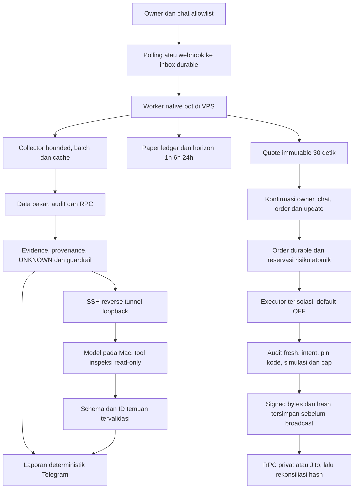
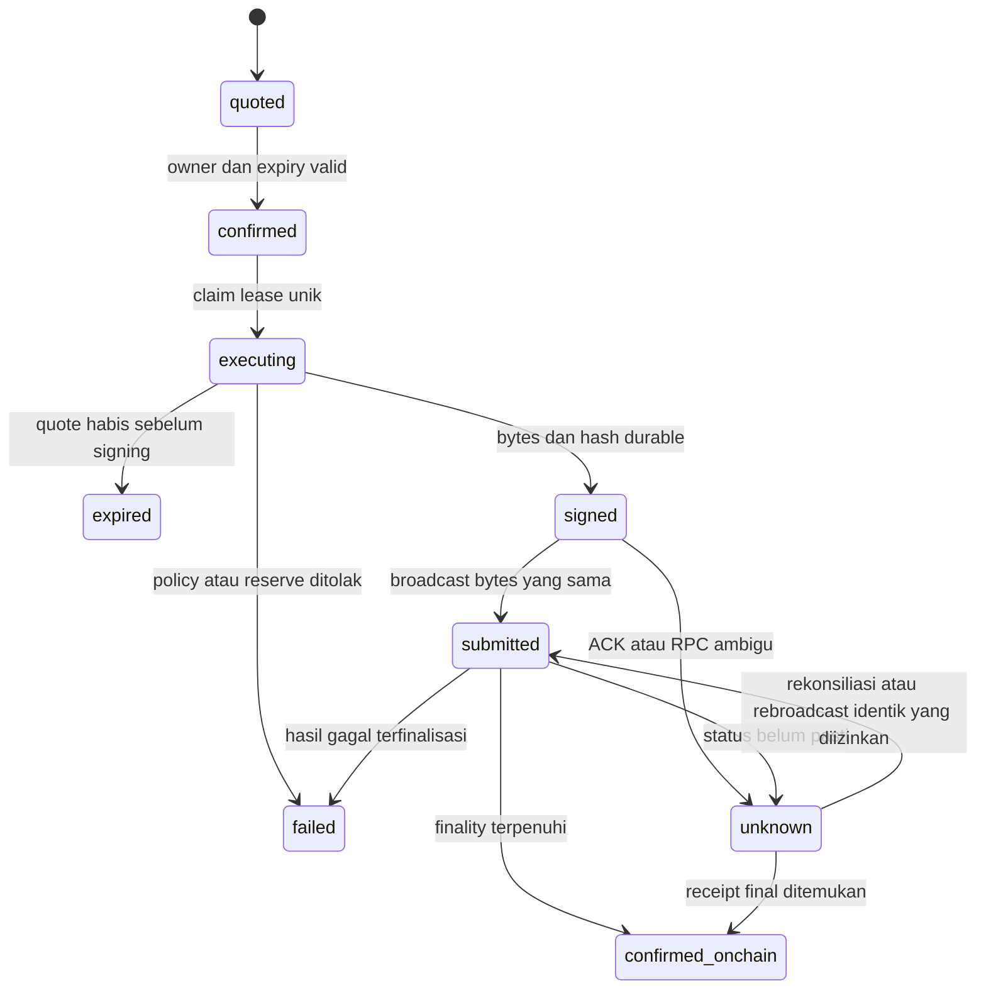

# Crypto Bot Hybrid: runtime VPS dan Hermes lokal MacBook

Status: implementasi lokal analisis, paper ledger, kuotasi, executor terpisah serta bootstrap/retensi; **live/auto OFF**, tidak ada transaksi uang riil. Tujuh migrasi dan restore ber-ACL diuji pada cluster PostgreSQL temporer lokal; belum diterapkan ke database produk/Supabase remote. MacBook/VPS belum dipasang atau deploy. Standar dan izin mengikuti [BOT_WORKFLOW.md](./BOT_WORKFLOW.md); status fase/bukti di [EXECUTION_PLAN.md](./EXECUTION_PLAN.md).

## 1. Keputusan dan scope

- Bot native memakai Node.js 24 dan dependency npm yang sudah ada. Entry point `frontend/scripts/bot.ts`, bukan Next.js server dan bukan backend seed statis.
- Supabase tetap penyimpanan produk. Tabel antrean baru menyimpan inbox, alert, checkpoint, serta intent konfirmasi; tidak mengganti database dengan D1 atau state laptop.
- Telegram hanya menerima owner dalam chat yang disetujui. Native HTTP bind `127.0.0.1:3005`; polling tidak perlu port publik. Webhook harus didaftarkan operator secara eksplisit dengan secret.
- MacBook dapat menjalankan model Nous Hermes melalui Ollama. `readonly_agent` di proyek ialah loop custom dengan tiga tool inspeksi in-memory, **bukan framework resmi NousResearch/hermes-agent**. Framework resmi model-agnostic dan tidak wajib menggunakan model Nous Hermes. Framework/tool shell/wallet belum dipasang.
- Output data dan angka dimiliki kode. Hermes memilih prioritas temuan melalui schema JSON; teks akhirnya dirender dari evidence yang dikenal. Tidak memberi AI izin membuat transaksi, mengambil secrets, atau mengubah scorecard.
- Kegagalan AI tidak menghentikan laporan deterministik. Tidak ada fallback ke model cloud berbayar otomatis.
- Konfigurasi lokal bukan bukti VPS Gomoku mempunyai RAM/CPU cukup. Ukur penggunaan aktual dan headroom sebelum co-hosting; konfigurasi memory limit Gomoku bukan penggunaan yang terukur.
- Proses `trader.ts` terpisah dari bot/Mac dan tidak dibuka oleh `bot:start`. Key berada di file owner-only di luar repository; tidak pernah masuk prompt, Telegram atau generic settings.

## 2. Yang dipangkas dan yang sengaja dipertahankan

| Area | Keputusan implementasi |
|---|---|
| `backend/index.js` statis | Backend seed, manifest/lockfile dan konfigurasi terkait dihapus setelah smoke penambahan watchlist melalui proses bot native lulus. Workspace, launcher dan Compose tidak mengaktifkannya; tidak menyalin seed ke DB. |
| Next.js/React/Tailwind | Tidak diimpor entrypoint bot. Dashboard opsional dipertahankan sampai seluruh gate paritas pengguna terbukti; bukan syarat runtime bot native. |
| `axios` | Masih diperlukan dashboard yang dipertahankan. Bukan dependency runtime yang diimpor bot; penghapusan menunggu cutover UI, bukan mengklaim hanya dua pemakaian. |
| Whitelist API | **Dipertahankan**: dashboard memanggilnya. Whitelist chain-scoped kini ikut menentukan VIP portfolio; blacklist mendapat prioritas. |
| Moralis untuk saldo native | Diganti batch JSON-RPC; ini bukan pengganti seluruh kemampuan histori/holdings Moralis. |
| Dex per token berulang | Shared service batch maksimal 30 alamat, concurrency terbatas, TTL dan single-flight. Cache negatif singkat. Tidak menjanjikan jumlah request/provider cost tertentu. |
| Top holder RPC berantai | Detail Solana memakai cache RugCheck dengan label sumber, waktu dan cakupan; tidak disamakan dengan audit on-chain lengkap atau Bubblemaps. |
| Metadata Metaplex | Fallback token yang belum mendapat metadata utama, batch dibatasi; tidak menghilangkan cakupan token non-DEX secara diam-diam. |
| Credential fallback dan auto webhook GET | Credential tidak disimpan di kode/dokumen. GET diagnostik tidak memanggil setWebhook. Key yang pernah terekspos tetap harus dirotasi oleh pemilik. |
| Scanner transfer-as-buy dan stored RSI | Menggunakan evidence swap dan delta quote lawan; selain itu UNKNOWN. RSI14 memakai candle 1h selesai; surge membandingkan baseline 20 candle, bukan nominal volume24h saja. |

## 3. Command dan paritas

Ketik `/help` atau `/menu`. Semua mutasi dipagari otorisasi lebih dahulu. Penghapusan individual memakai konfirmasi yang terikat user, chat, expiry, dan update ID; retry update yang sama dapat melanjutkan intent tanpa token dipakai update lain.

| Kemampuan | Command |
|---|---|
| Ringkasan dan daftar | `/summary`, `/watchlist [halaman]`, `/coins [halaman]` |
| Wallet CRUD, rename, pin | `/addwallet`, `/renamewallet`, `/pinwallet`, `/delwallet` dengan chain dan alamat |
| Coin CRUD, rename, pin | `/addcoin`, `/renamecoin`, `/pincoin`, `/delcoin` dengan chain dan kontrak |
| Whitelist dan blacklist | `/whitelist`, `/allow`, `/unallow`, `/blacklist`, `/block`, `/unblock` |
| Holdings dan riwayat | `/portfolio <chain> <wallet> [halaman]`, `/history <chain> <wallet> <kontrak> [halaman]` |
| Pasar dan audit | `/analyze <chain> <kontrak>`, `/search`, `/holders`, `/trades`, `/indicators` |
| Scanner dan settings | `/scan`, `/settings`, `/set ENABLE_COIN_SCANNER true|false` |
| Paper virtual | `/paper [1h|6h|24h]`, `/paper open <chain> <token> <notionalUSD>`, `/paper evaluate` |
| Kuotasi | `/quote <chain> <input|native> <output|native> <amountRaw> <maxUSD> <slippageBps>` |
| Order dan circuit breaker | `/trade`, `/trade kill`, `/trade reset`; eksekusi hanya melalui tombol quote |

Saldo native bukan total net worth. Harga/saldo/metadata yang tidak tersedia harus unknown, bukan nol. Alamat EVM tanpa chain meminta pilihan; paste alamat Solana meminta pilihan token atau wallet. Solana Base58 case-sensitive. EVM chain berbeda tetap aset berbeda.

Riwayat provider terbatas bukan histori lengkap. Source yang gagal tidak berarti token aman. Pemantauan swap wallet saat ini **Solana melalui Helius**; wallet EVM yang belum memiliki sumber swap diberi warning, bukan diklaim dipantau. Tidak ada transaksi uang riil.

## 4. Kontrak analisis dan AI

`coin-analyzer.ts` mengambil DexScreener, RugCheck+Jupiter untuk Solana, GoPlus untuk chain EVM yang didukung. Jupiter dapat memerlukan `JUPITER_API_KEY`; kegagalan dilaporkan sebagai sumber tidak tersedia. RPC/provider publik tetap memiliki limit dan ketentuan sendiri.

Laporan mempertahankan supply raw/decimals, angka holder per sumber dan konflik, sample non-pool dengan cakupan, status otoritas, klaim lock hanya pool terkait, volume, organic score dan timestamp. Wallet owner digabung dalam sample. Hubungan transfer bukan identitas insider; network dapat tumpang tindih. **Data peta Bubblemaps aktual tidak dikumpulkan otomatis**: laporan memberikan tautan peta dan menyatakan batas tersebut. Tidak mengiklankan graf RugCheck sebagai hasil Bubblemaps.

Simulasi constant-product hanya untuk pool kompatibel dengan reserve diketahui, bukan DLMM/CLMM. Hasil bukan quote eksekusi atau prediksi; mengabaikan fee, routing, arbitrase dan order baru.

`hermes-ai.ts` hanya memakai endpoint private/loopback yang dikonfigurasi server, path `/v1/chat/completions`, tanpa redirect. Payload berupa metric/finding allowlist, bukan chat/wallet history. Model mengembalikan `finding_ids`; angka/prosa/link/tool output di luar schema ditolak. Satu inference aktif, output/body/deadline terbatas, circuit cooldown. Temperature rendah bukan jaminan bebas halusinasi. Kualitas prioritisasi model belum diukur tanpa evaluasi di Mac.

Body setiap langkah model dibatasi 16 KiB dan deadline gabungan maksimal8 detik; JSON langkah wajib tepat satu key `tool` dari enum lokal, final maksimal4 ID unik. Hasil sekarang menyertakan `findingIds` untuk provenance paper. Output bebas model, parameter transaksi, recipient, size atau policy tidak pernah diterima. Guardrail lama yang memberi PASS pada `token:{}` direproduksi dan diperbaiki: authority/holder/tax/program unknown memblokir; audit yang diketahui stale/future memblokir; umur audit tidak diketahui tetap WARN, bukan aman.

## 5. Setup database dan runtime lokal

1. Pilih Supabase **uji/staging terisolasi**. Jangan menunjuk production untuk smoke. Skema existing harus mempunyai `watchlist`, `tracked_coins`, `blacklist_tokens`, `whitelist_tokens`, `app_settings` sesuai API saat ini.
2. Tinjau dan jalankan secara sengaja, berurutan:
   - `supabase/migrations/20261106_base_schema.sql` (baru: bootstrap fresh; existing tidak diubah diam-diam)
   - `supabase/migrations/20261107_bot_runtime.sql`
   - `supabase/migrations/20261107_whitelist_chain.sql`
   - `supabase/operations/preflight.sql` (gate read-only)
   - `supabase/migrations/20261108_identity_constraints.sql`
   - `supabase/migrations/20261109_paper_trading.sql`
   - `supabase/migrations/20261110_trade_execution.sql`
   - `supabase/migrations/20261111_bot_retention.sql`
   - `supabase/operations/verify.sql` (RLS, table/column grant dan EXECUTE)
3. Constraint identitas normalisasi sengaja gagal bila data legacy mempunyai alias duplikat; jangan auto-delete. Inventaris pasangan canonical chain/address dan rekonsiliasi oleh pemilik sebelum mengulang migrasi. Baris whitelist lama tanpa chain tidak ditebak sebagai Ethereum/Solana.
4. Salin `frontend/.env.example` ke `frontend/.env.local` dan isi sendiri. `SUPABASE_KEY` harus role server yang terscope; jangan kirim ke Telegram atau Mac. Tabel runtime mengaktifkan RLS dan membatasi fungsi/tabel ke service role.
5. `TELEGRAM_ALLOWED_USER_IDS` untuk identitas user, `TELEGRAM_ALLOWED_CHAT_IDS` untuk chat yang boleh mengirim perintah, `TELEGRAM_CHAT_ID` untuk tujuan alert. Bukan satu ID untuk semua fungsi.
6. Jalankan `npm ci`, kemudian `npm run bot:start` dari root. Launcher Windows `local-tracker.bat` memeriksa prasyarat, tidak install otomatis atau menyuntik seed.
7. `GET http://127.0.0.1:3005/health` mengecek kesiapan penyimpanan. API lain memerlukan Bearer `BOT_API_TOKEN` minimal32 karakter. Jangan taruh token dalam URL.
8. Dashboard opsional: `npm run dev:frontend`; Basic Auth username `owner`, password `BOT_API_TOKEN`. Atur `BOT_ALLOWED_ORIGINS` untuk origin yang memang dipakai. Public deployment wajib TLS, bukan Basic Auth di HTTP publik.

Default transport polling memeriksa webhook existing dan menolak berjalan bila webhook masih terpasang. Tidak delete/set webhook otomatis. Untuk webhook, set `BOT_TRANSPORT=webhook`, pilih ingress TLS yang disetujui, daftarkan URL+secret secara terpisah dan pastikan worker native tetap hidup. Next route hanya menerima durable inbox; bukan daemon.

`scripts/crypto-bot.service` adalah contoh unit systemd **belum di-install/enable**. Gunakan user, folder, environment file dan caps resource terpisah dari Gomoku. Jangan memberi bot akses Docker socket, signer game, root SSH, DB/Redis game atau volume game. Polling tidak memerlukan modifikasi Caddy game.

## 6. Setup Hermes native pada MacBook

Belum ada koneksi/inspeksi MacBook pada task ini. Identitas chip, RAM, storage, model terpasang, dan jaringan harus diperiksa pada Mac. Tidak mengasumsikan M1 runner berarti punya headroom inference.

1. Pasang Ollama **native macOS** dari [situs resmi](https://ollama.com/download/mac), mengikuti minimum macOS/vendor saat instalasi. Jangan jalankan model melalui Docker Desktop di Mac bila mengharapkan GPU Metal.
2. Dari checkout proyek pada Mac, `bash scripts/hermes/mac-hermes.sh check`.
3. Di terminal pertama: `bash scripts/hermes/mac-hermes.sh serve`. Default bind **127.0.0.1**, satu model, satu request paralel, context4096, queue4, keep-alive5m, cloud dimatikan. Quit instance Ollama GUI lain lebih dahulu secara sengaja bila port sama sudah dipakai; script tidak membunuh proses lain.
4. Di terminal kedua: `ollama pull hermes3:8b` (download memerlukan jaringan/storage), lalu `bash scripts/hermes/mac-hermes.sh create` untuk membuat `hermes-crypto-analyst` dari Modelfile yang dilacak.
5. Periksa `ollama ps`, Activity Monitor memory pressure/swap dan respons saat runner CI Gomoku aktif. Tidak ada klaim token/detik atau RAM pasti. Jika model8b terlalu berat, evaluasi tag lebih kecil yang benar-benar tersedia, ubah FROM secara sengaja dan ulang evaluasi. Jangan menjanjikan model8b aman pada RAM8GB.
6. `HERMES_FLASH_ATTENTION=1 bash scripts/hermes/mac-hermes.sh serve` mengaktifkan optimasi opsional; KV q8_0 dapat mengubah presisi. Bandingkan sebelum/sesudah, bukan klaim tanpa kehilangan akurasi. Default parallel1 menghindari penggandaan context karena concurrency.
7. Opsional, di charger dengan tutup laptop terbuka: `HERMES_KEEP_AWAKE_AC=1 bash scripts/hermes/mac-hermes.sh serve`. `caffeinate -s` tidak menjamin lid-close tetap hidup dan tidak mengubah kebijakan sleep global. Saat Mac sleep/offline bot tetap memberi scorecard deterministik.
8. Setelah model siap, `bash scripts/hermes/mac-hermes.sh smoke` mengirim evidence sintetis dan memvalidasi schema/allowlist output dengan Node proyek. Gagal schema/timeout harus diperbaiki sebelum tunnel diaktifkan; smoke bukan pengukuran kualitas atau profitabilitas.

### Koneksi VPS ke Mac tanpa mengekspos Ollama

Default yang disiapkan ialah SSH reverse tunnel terenkripsi. Tidak perlu membuka port router atau mengubah binding Ollama menjadi0.0.0.0.

- Provision akun/key SSH terbatas secara terpisah di VPS, verifikasi host key. Operator harus membatasi remote forwarding ke listen loopback11435 dan `GatewayPorts no`; jangan memakai akun root atau key deployment Gomoku.
- Pada Mac: `HERMES_VPS_SSH=akun-terbatas@host-vps bash scripts/hermes/mac-hermes.sh tunnel`.
- Tunnel memetakan **127.0.0.1:11435 di VPS** ke **127.0.0.1:11434 di Mac**. Host lain di VPS tetap boundary trust; user/service separation diperlukan.
- Isi env bot di VPS: `HERMES_API_URL=http://127.0.0.1:11435/v1/chat/completions`, `HERMES_MODEL=hermes-crypto-analyst`, `HERMES_TIMEOUT_MS=5000`.
- Tailscale boleh sebagai alternatif setelah setup jaringan/ACL disetujui. Bind ke IP Tailscale tidak otomatis membatasi hanya satu device; ACL harus membatasi sumber bot dan port. Jangan expose API Ollama tanpa auth/ACL pada internet/LAN publik.
- Script tidak install tool, menulis launchctl/pmset, mengubah runner game, atau meregistrasi service Mac.

## 7. Reliability, failure dan recovery

- Webhook ACK sesudah insert inbox berhasil; update_id dedupe termasuk0. Polling offset dipersist sesudah enqueue. Owner diperiksa ulang ketika job diproses.
- Queue memakai claim transaksi global, lease yang diperbarui, maksimal4 attempt dan terminal failed yang dapat diperiksa. State scanner mempunyai fencing lease. Konfirmasi dipersist sebagai intent terikat update.
- Alert disimpan sebelum dikirim. Cursor/backfill satu checkpoint atomik; workload per scan dibatasi dan backfill dilanjutkan. Harga hilang membuat job enrichment, bukan transaksi dianggap nol. Retry enrichment melewati TTL cache; exhausted enrichment tetap visible failed, bukan sukses.
- Tetap ada jendela duplikasi bila Telegram menerima pesan tetapi pencatatan sukses gagal. **Tidak ada exactly-once end-to-end**. Mutasi ulang harus direkonsiliasi melalui state aktual.
- Operator hanya meninjau retry job failed yang payload-nya masih ada; jangan replay massal command destruktif. Maintenance UTC memakai terminal_at dan lease, maksimum10batch5000. Job periodik yang aman dihapus setelah14hari; update dan job berefek samping menjadi tombstone pruned tanpa payload setelah14/30hari. Pruned tidak claimable dan ID tetap melindungi dedupe. Konfirmasi expired yang melindungi update pending/running/failed ditahan. Ledger/cursor tidak dipangkas; tombstone tetap dapat tumbuh. Kontrak dan bukti: [EXECUTION_PLAN.md](./EXECUTION_PLAN.md).
- Cadangan/recovery database produk tetap gate rollout terpisah. Fixture HTTP bukan bukti SQL; skenario migrasi dan concurrency lokal PostgreSQL nyata dicatat pada bagian verifikasi, tanpa mengklaim deployment Supabase sudah diuji.

## 8. Verifikasi dan batas

Entry point checks: `npm run check`, `npm run test:frontend`, `npm run test:all`. Suite integrasi menjalankan proses bot asli dengan service eksternal fixture lokal dan environment sintetis; tidak menyentuh Telegram/DB production.

Bukti pada implementasi lokal ini:

| Pemeriksaan | Hasil diamati |
|---|---|
| `npm run check` | Lulus `next typegen` dan TypeScript. |
| `npm run test:all` | 136/136 lulus, 0 skipped. Termasuk16skenario subprocess bot asli dengan maintenance failure/retry/restart, paper/quote dan owner command. HTTP provider/PostgREST/Telegram sintetis loopback, bukan layanan production. |
| Typecheck test runtime/integrasi | Lulus strict TypeScript targetES2024 pada task retensi. |
| `npm run build:frontend` | Next.js production build lulus. Build bukan bukti interaksi UI atau build Docker. |
| Historis task trading: signer dan recovery | Signature EVM ephemeral serta lost ACK/restart telah diuji; bukan pengujian transaksi chain live. |
| Historis task trading: reproduksi guardrail dan leakage | Audit kosong PASS→BLOCKED, alias token train/holdout diterima→ditolak. Test regresi masih termasuk suite saat ini. |
| Git Bash `bash -n scripts/hermes/mac-hermes.sh` | Syntax lulus; bukan eksekusi macOS, inference atau tunnel. |
| Historis task trading: replay CLI sintetis | Fixture version1 membuktikan prosedur; bukan profit nyata. |
| Historis task trading: executor CLI OFF dan reconcile-only | Subprocess tanpa key/submission; receipt sintetis. Tidak diaktifkan ulang untuk task retensi. |
| PostgreSQL17.11 task retensi | Tujuh migrasi pada database kosong dan reapply dengan existing maintenance/tombstone lulus. Terminal-age, boundary/batch, fence, dedupe, confirmation dan preservasi ledger/cursor lulus. |
| Bundle/privilege gate | Bundle CLI lulus; alias duplikat serta column-only grant anon ditolak. |
| Backup/restore sintetis | CLI dump ber-ACL, restore isolated, isi12tabel + gate privilege cocok. Bukan backup/recovery produk. |
| Historis task trading: balapan reserve | Dua sesi reserve7 dengan budget10 pernah membuktikan satu diterima/satu ditolak; bukan rerun pada task retensi. |
| Review keamanan terpisah | Re-review statis tidak menemukan HIGH/MED blocking pada perubahan yang diperiksa. Bukan sertifikasi production. |

Belum diuji: deployment Supabase/PostgREST nyata, Telegram/provider/chain live, model Hermes dan tunnel Mac, evaluasi kualitas AI berlabel/holdout, benchmark VPS/Gomoku, Docker build, systemd/permission host dan recovery database produk. Replay sintetis membuktikan prosedur/aritmetika, bukan profitabilitas AI. Cluster SQL temporer bukan database pengguna.

Gate UI removal: CRUD/rename/pin, pagination, portfolio, history/trades/holders/indicators, blacklist/whitelist, settings, error handling dan interaksi Telegram harus terbukti pada surface yang disepakati. Sementara gate belum lengkap, UI/axios tetap ada tetapi tidak menjadi beban runtime bot native. Jangan menganggap keberadaan command sama dengan acceptance pengguna.

Gate AI: pada Mac evaluasi kasus berlabel dan holdout (data hilang, konflik holder, pool exclusion, cluster tanpa identitas, mint/freeze, tokenmetadata injection), bandingkan pemilihan temuan dengan baseline deterministik. Ukur latency cold/warm, memory pressure, timeout, invalid-schema rate; jangan menilai dengan impresi narasi. Tidak ada training/fine-tuning atau dataset wallet pribadi otomatis.

Tidak tercakup dalam izin lokal: rotasi key di provider, install Mac/VPS/Tailscale, perubahan jaringan Caddy/firewall/GatewayPorts, migrasi remote, commit/push/PR/merge/deploy, dan transaksi finansial.

## 9. Hasil Audit Codebase, Pembersihan & Optimasi

### A. File Usang & Duplikat yang Dihapus
- **Direktori `backend/` & seluruh berkasnya**: Dihapus tuntas setelah watchlist dinamis dan smoke proses native lulus.
- **`frontend/package-lock.json`**: Dihapus karena duplikat terhadap workspace lockfile tunggal di root `package-lock.json`.
- **`frontend/docker-compose.yml`**: Dihapus karena duplikat usang dan mengekspos `"3000:3000"` ke `0.0.0.0` (berbeda dengan root `docker-compose.yml` yang mengikat `127.0.0.1:3000:3000`).
- **`tracker.bat`**: Dihapus karena hanya pembungkus 3 baris ke `local-tracker.bat`.
- **`frontend/README.md`, `frontend/CLAUDE.md`, dan 5 SVG template di `frontend/public/`**: Dihapus karena boilerplate `create-next-app` yang tidak dipakai kode.
- **Duplikasi `NETWORK_MAP`**: Disatukan ke `frontend/app/lib/utils.ts` (`getNetworkSlug`) sehingga `indicators/route.ts` dan `scanner.ts` memakai satu sumber pemetaan jaringan.

### B. Optimasi Performa & Kuota API yang Diterapkan
- **Single-Flight & TTL Cache Harga Native (`fetchNativeCoinPrice`)**: Permintaan harga native CoinGecko pada `/api/tokens` dan `/api/solana` kini berbagi satu in-flight promise dan cache 60 detik (5 detik untuk kegagalan), mengurangi request berulang. Bukan jaminan bebas HTTP429 atau angka penghematan kuota yang sudah diukur.
- **JSON-RPC Batch untuk `alchemy_getTokenMetadata`**: Di `/api/tokens`, pengambilan metadata token EVM yang belum ada di cache tidak lagi mengirim HTTP POST satu per satu, melainkan digabung dalam JSON-RPC batch (25 kontrak per POST).
- **Stream Reader Terbatas Terpadu (`readBoundedJson`)**: `coin-analyzer.ts` kini menggunakan helper `readBoundedJson` terpusat untuk batas ukuran byte dan deadline waktu baca.
- Docker dashboard diperbaiki setelah penghapusan lockfile frontend: konteks root, root workspace lockfile, Node24, `npm ci`, dan root `.dockerignore` yang menolak env/key. Tidak menyalakan Docker. Pembatasan response/settings dan freshness dibuat sebagai prasyarat money path, bukan peningkatan profit.

### C. Kapabilitas Baru yang Ditambahkan
- **Deterministic Trade Guardrail Engine (`evaluateTradeGuardrails`)**: Setiap hasil `/analyze` kini mengevaluasi gerbang keselamatan deterministik (`PASS` | `WARN` | `BLOCKED`) berdasarkan ketersediaan audit, deteksi honeypot GoPlus, `freezeAuthority` Solana, pajak beli/jual EVM $>5\%$, likuiditas minimum $\$10.000$, Token-2022 transfer fee, dan konsentrasi holder/network.
- **Mode Hermes Read-Only Agent (`HERMES_AGENT_MODE=readonly_agent`)**: Mendukung loop *tool-calling* terbatas (maksimal 2 langkah) pada bukti in-memory (`inspect_holder_distribution`, `inspect_pool_scenarios`, `inspect_audit_and_guardrails`) sebelum menghasilkan JSON `finding_ids` tervalidasi schema. Nama tool di luar allowlist (seperti `buy_token`) langsung ditolak.
- **Subcommand `smoke` pada `scripts/hermes/mac-hermes.sh`**: Memudahkan pengujian respons JSON schema dan latensi `hermes-crypto-analyst` secara lokal di Mac sebelum menyambungkan SSH tunnel ke VPS.

## 10. Eksekusi roadmap lokal dan gate aktivasi

### Tahap 1 — Analisis dan loop read-only

Kode deterministik tetap pemilik angka/otorisasi. `HERMES_AGENT_MODE=stateless` melakukan satu inference; `readonly_agent` maksimal dua langkah inspeksi lalu satu seleksi ID. Tidak ada akses shell, key, wallet atau transaksi oleh model. Kecepatan, RAM dan kualitas model belum diukur di Mac.

Koreksi penjelasan sebelumnya: Hermes Agent resmi adalah runtime otonom model-agnostic, bukan nama lain model `hermes3:8b` dan bukan loop custom ini. Jika kelak dipasang, gunakan akun/profil Mac terpisah, nonaktifkan tool shell/filesystem/browser/gateway yang tidak dibutuhkan, batasi tool ke collector read-only, dan jangan jalankan Telegram gateway kedua dengan token bot yang sama. Tidak ada klaim kebal prompt injection atau jaminan keselamatan dari schema saja. Migrasi ke framework resmi memerlukan review API/toolset dan smoke terpisah; keberadaannya tidak diperlukan untuk signing deterministik.

### Tahap 2 — Paper ledger dan replay: tersedia di kode

- `paper-trading.ts` dan `20261109_paper_trading.sql`: entry immutable per `signalId`, actor/chat, chain/token, notional/cost decimal string, evidence/guardrail pada entry, `findingIds` dan status Hermes, serta mark 1h/6h/24h.
- `/paper open` memakai konfigurasi biaya eksplisit. Bila `PAPER_ENABLED=true`, BUY Solana yang mempunyai bukti swap dan melewati ambang alert dapat diantrekan sebagai kandidat paper; maksimal2 kandidat per scan dan cakupan dilaporkan tidak lengkap. Paper tidak menerima unknown price sebagai nol.
- Entry memakai harga saat benar-benar dikoleksi, bukan harga saat whale bertransaksi. Proses evaluasi periodik per menit membatasi8 entry/batch. Observasi lewat toleransi5 menit berstatus delayed; provider gagal unavailable; keduanya tidak dihitung sebagai hasil profit/loss. Likuiditas teramati0 dapat dicatat sebagai skenario kehilangan seluruh nilai, bukan menyamakan token tidak ditemukan dengan rug pull.
- Biaya entry/exit dan slippage kedua sisi dikurangi. Baseline mencakup semua entry; cohort filter memerlukan hasil Hermes valid dan hanya mengecualikan temuan adverse yang didukung angka/fakta entry. Ini evaluasi filter evidence, **bukan strategi BUY dari ranking**.
- `/paper` menyebut coverage, mean net return, win rate dan maximum decline cumulative-return dengan notional setara. Itu bukan equity/drawdown portfolio yang tumpang tindih. Data missing tetap denominator coverage, bukan dihilangkan diam-diam.
- `npm run paper:replay -- test/fixtures/paper-replay.json` membaca dataset sintetis version1 secara offline; mencegah entry/observasi melewati as-of, label train melewati cutoff, dan token train muncul pada holdout termasuk alias chain serta EVM address case. Solana tetap case-sensitive. Fixture kecil membuktikan prosedur, tidak mengukur kualitas AI atau return nyata.

### Tahap 3 — Quote dan konfirmasi: tersedia di kode

- `swap-quotes.ts` memakai **Jupiter Swap API V2 `/build`** dan **0x V2 AllowanceHolder `/quote`**, menggantikan rujukan v6 yang usang. Provider tetap mempunyai kuota/key/fee; tidak ada pembelian resource otomatis.
- Input integer RAW tidak melewati floating point. `amountOutRaw`, `minOutRaw`, slippage, token/chain/taker, expiry dan unsigned build divalidasi; quote hasil `createdAt` asli maksimal30 detik, parser tidak memperbaruinya. Harga impact/tax/network fee yang tidak disediakan tampil UNKNOWN, tidak dikarang sebagai0.
- Order ID stabil berasal dari chat/update; quote immutable diberi digest. Konfirmasi Telegram terikat actor/chat/order/update dan dicek expiry ulang di SQL. Retry update yang sama melanjutkan order sama; tidak merequote/re-sign diam-diam. Tombol lama bukan izin quote baru.
- `/trade` menampilkan status order/hash dan risk switch. `/trade kill` menghentikan signing/rebroadcast baru, tetapi tidak membatalkan transaksi yang sudah disiarkan. `/trade reset` memakai konfirmasi owner dan hanya membuka switch, tidak menghapus budget.

### Tahap 4 — Executor terisolasi: tersedia di kode, live OFF

- Jalankan `npm run trade:worker -- --once` tanpa konfigurasi untuk memeriksa OFF: tidak membuka DB/key/provider. Environment signer terpisah `frontend/.env.trader.local` dari `.env.trader.example`; jangan gabungkan dengan env bot/Mac. Unit `scripts/crypto-trader.service` hanya contoh, user/group terpisah, belum dipasang.
- `TRADE_LIVE_ENABLED`, chain allowlist, public taker, RPC privat, file key owner-only, seluruh limit USD/raw fee, finality dan pin code harus ditetapkan operator. Tidak ada default nominal uang. `MAX_SLIPPAGE_BPS` maksimal150; minimum received juga dibandingkan dengan valuasi spot konservatif, bukan diklaim ukuran impact eksekusi yang pasti.
- Risk model wajib dipilih eksplisit `conservative-capital-at-risk`: seluruh notional+cap biaya dianggap dapat hilang. SQL memeriksa per-trade cap, daily-loss budget UTC dan exposure kumulatif atomik. Penolakan melewati budget melatch kill switch. **Bukan realized-PnL accounting**; tidak ada refund, pelepasan exposure, pergantian hari atau reset budget otomatis, sehingga lebih konservatif daripada batas loss aktual.
- Semua transisi memakai lease/token dan expected state SQL. Hanya signed bytes yang sudah durable boleh di-broadcast; retry mencari hash/receipt yang sama, tidak membuat nonce/blockhash baru. Lost persistence ACK tetap ambigu, bukan dianggap gagal yang membolehkan transaksi pengganti. `--reconcile-only` hanya klaim signed order, query status tanpa key/signing/broadcast.
- EVM: chain ID aktual, AllowanceHolder exec/Settler slippage recipient-token-amount-min, pin keccak bytecode, simulation `eth_call`, nonce pending/latest, saldo dan gas cap diperiksa. Approval tidak otomatis: token input harus mempunyai **exact allowance**, bukan unlimited. Tidak ada approval ke Settler.
- GoPlus tidak menjanjikan timestamp audit. Umur unknown tetap WARN. Pengecualian operator hanya untuk sole warning tersebut melalui `TRADE_EVM_ASSET_REVIEWS`: chain:asset, code hash, reviewedAt/expiresAt maksimal24h; RPC memeriksa code sama dan `owner()==0`. **Owner nol/code hash tidak membuktikan tiadanya AccessControl roles, controller eksternal, hardcoded privilege, delegatecall/proxy/beacon atau state lain yang masih bisa mengubah fee/blacklist/mint.** Pin dilarang dibuat hanya dari `owner()==0`, flag provider atau output AI; review independen wajib memeriksa seluruh sumber mutabilitas. Pengecualian tidak menghapus warning atau mengatasi audit yang diketahui stale, active mint, honeypot maupun warning lain.
- Solana: legacy SPL dengan authority on-chain dicabut, mint/token account owner, genesis jaringan, pin deployed Jupiter ProgramData, LUT on-chain, beneficiary ATA, amount/slippage ABI route/shared_accounts_route yang ditinjau, setup/cleanup terbatas dan simulasi delta saldo diperiksa. Variant ABI baru/Token-2022 tidak ditebak. Fee dan tip Jito dibatasi; program upgrade/pin berubah memblokir. Recovery memverifikasi Ed25519 dan menunggu finalized untuk hasil sukses/gagal.
- Jalur submission Solana memakai Jito bundleOnly dengan tip yang dipin; EVM memerlukan RPC private yang disetujui operator. Ini mitigasi, **bukan jaminan bebas MEV/sandwich**. Base/Optimism/Arbitrum mendukung read-only quote tetapi signing sengaja ditolak: L1 data/operator fee belum mempunyai hard bound yang disetujui. Tidak mengklaim seluruh chain/route sudah didukung live.
- `TRADE_AUTO_ENABLED=false`. Engine tidak menciptakan strategi entry/exit, ukuran posisi, stop-loss atau izin finansial dari ranking model. Auto strategy memerlukan keputusan pemilik dan evaluasi paper terpisah; flag tidak menghapus requirement konfirmasi order pada implementasi ini. Tidak ada auto-trading aktif.

### Urutan rollout yang masih memerlukan operasi pemilik

1. Review/apply migrasi pada Supabase uji, preflight legacy identity dan uji koneksi PostgREST menggunakan credential uji terscope; cadangan/recovery drill sebelum data produk. Langkah, query dan acceptance: [EXECUTION_PLAN.md](./EXECUTION_PLAN.md).
2. Konfigurasi bot owner/chat/provider dan paper costs; exercise command/alert di Telegram uji. Buktikan missing/late coverage, downtime dan restart tanpa memakai dana.
3. Setup Mac native, smoke schema, ukur memory pressure/latency cold-warm dan runner Gomoku; buat akun/tunnel terbatas. Jangan memindahkan secrets/trading signer ke Mac.
4. Pilih dedicated hot wallet, nominal budget, chain/routes, pin code/review independen dan finality/fee policy secara eksplisit. Uji signer dengan key sintetis dan jaringan aman sebelum memberi izin uang riil.
5. Aktivasi live adalah operasi tersendiri, bukan akibat task lokal atau `npm ci`. Saat insiden: kill, stop signer, pertahankan signed bytes/hash/reservasi, reconcile-only dan audit receipt; jangan menghapus row/replay massal atau menandatangani pengganti atas status unknown.

## Rujukan vendor

- [Ollama FAQ: binding, concurrency, keepalive, Flash Attention dan KV quantization](https://docs.ollama.com/faq)
- [Ollama structured outputs](https://docs.ollama.com/capabilities/structured-outputs)
- [Hermes3 model registry](https://ollama.com/library/hermes3)
- [Jupiter Tokens](https://developers.jup.ag/docs/tokens)
- [Bubblemaps map semantics](https://docs.bubblemaps.io/data/api/tokens/map)
- [Hermes Agent resmi dan dukungan model](https://github.com/NousResearch/hermes-agent)
- [Jupiter Swap V2](https://developers.jup.ag/docs/swap.md), [Build](https://developers.jup.ag/docs/swap/build.md), [IDL route yang ditinjau](https://github.com/jup-ag/jupiter-cpi/blob/main/idl.json)
- [0x V2 quote](https://docs.0x.org/api-reference/evm-ap-is/swap/allowanceholder-getquote.md), [AllowanceHolder dan Settler](https://docs.0x.org/docs/core-concepts/contracts.md)
- [Jito low-latency transaction submission](https://docs.jito.wtf/lowlatencytxnsend/)
- [OP Stack fee components dan keterbatasan L1 fee cap](https://docs.optimism.io/op-stack/transactions/fees)
